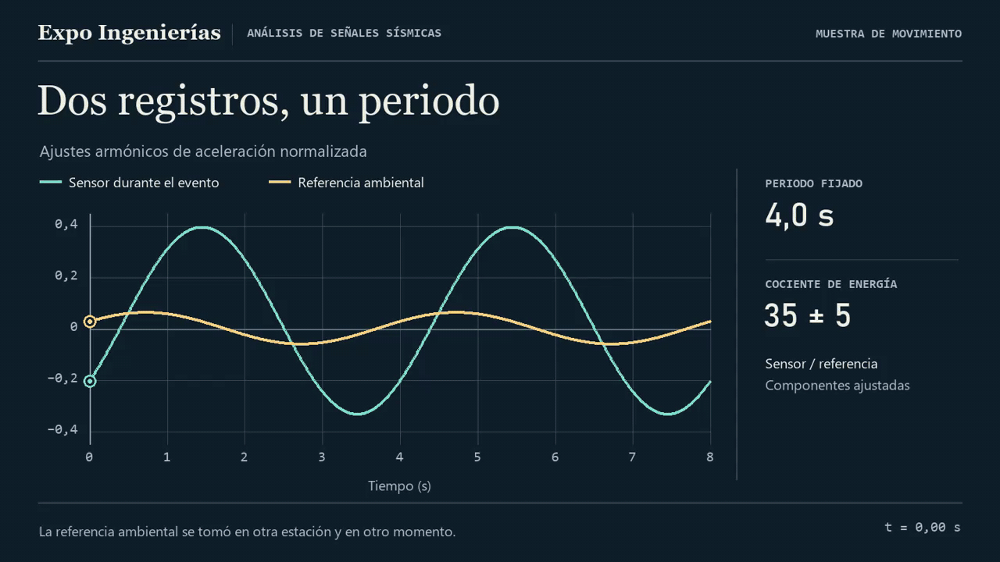

# Dos registros, un periodo

Video de Expo Ingenierías que compara los ajustes armónicos del sensor durante el evento y de la referencia ambiental en una escala común.

[Ver o descargar el video MP4](./Expo-Ingenierias.mp4) · [Abrir el GIF](./Expo-Ingenierias-dos-registros.gif) · [Ver la portada](./Expo-Ingenierias-portada.png)

